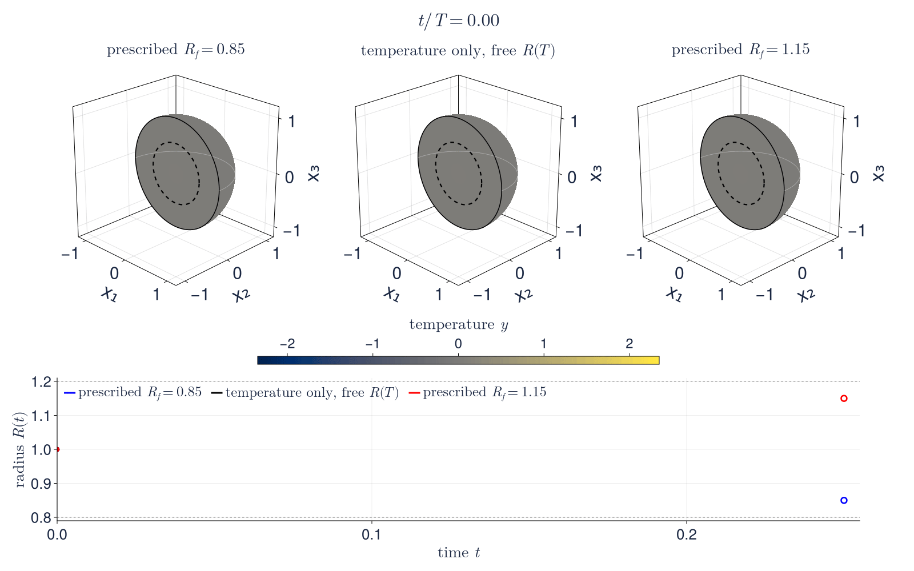
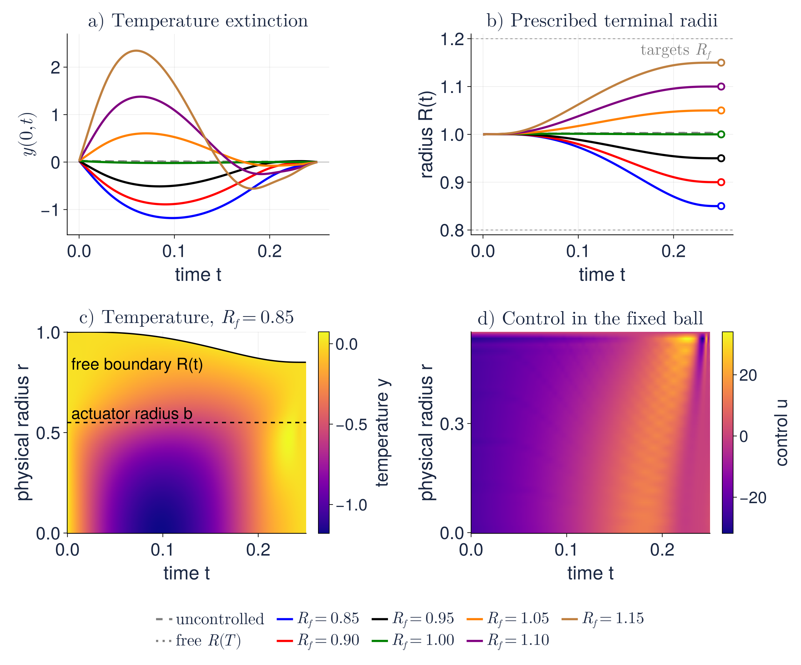
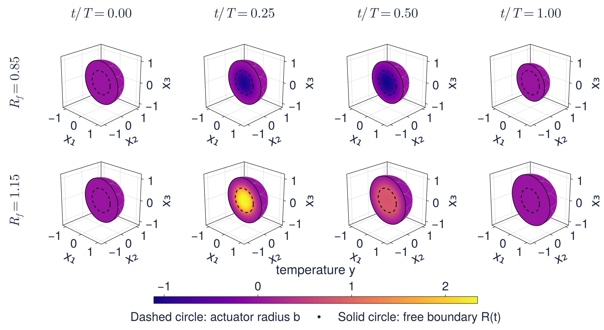
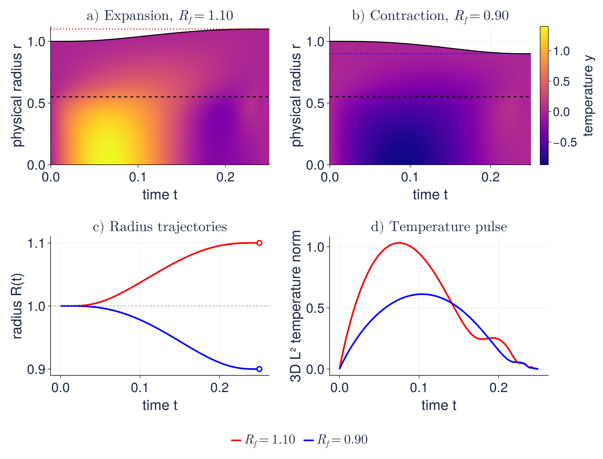
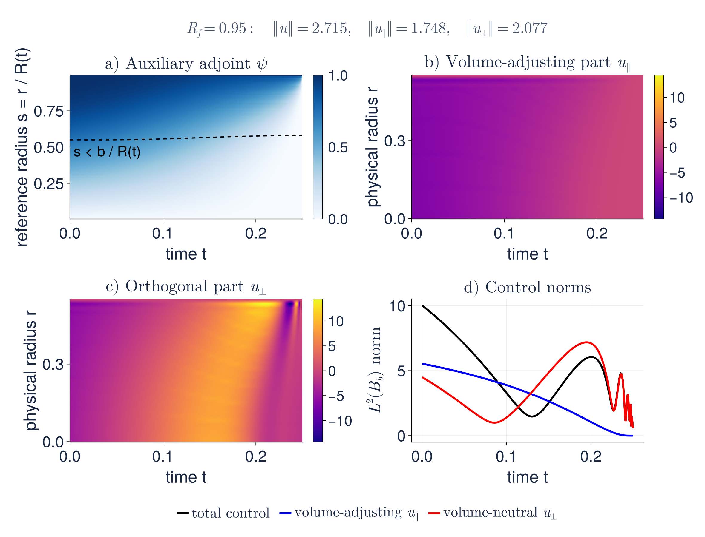
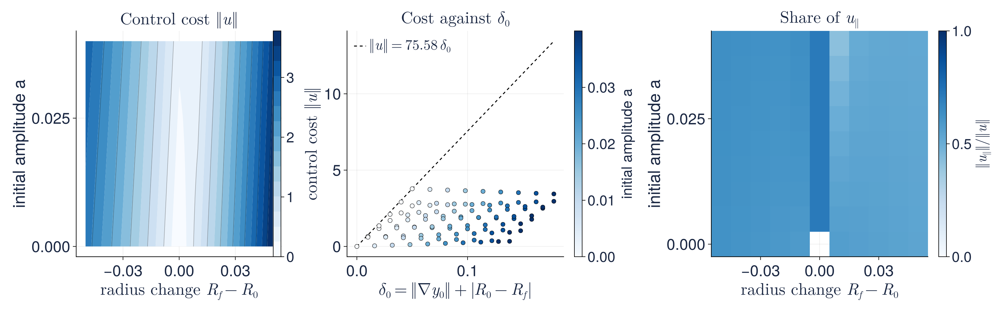
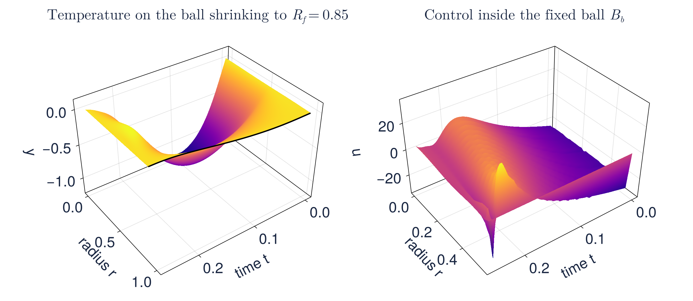

# Null controllability of a radial Stefan problem with prescribed terminal radius

**Daniel Fernández**

[](https://arxiv.org/abs/2511.10795)
[](Project.toml)
[](Project.toml)
[](REPRODUCING.md)
[](checksums.sha256)
[](test/runtests.jl)
[](CITATION.cff)

[Use and verify the results](REPRODUCING.md) · [Experiments and figures](#experiments-and-figures) · [Data](data/README.md) · [Citation](CITATION.cff)

<p align="center">
  <a href="figures/animation/stefan_domain_control_still.png">
    
  </a>
</p>
<p align="center"><sub>Three controls from the same initial temperature, acting only inside the dashed circle of radius <i>b</i> = 0.55. Left and right: the free boundary is steered to the prescribed radii <i>R<sub>f</sub></i> = 0.85 and 1.15 while the temperature is driven to zero. Middle: the temperature-only control of the earlier experiments, which leaves the radius free. The traces below are the computed radii and the hollow circles their prescribed targets. <a href="figures/animation/stefan_domain_control_still.png">Final frame</a>.</sub></p>

Water occupies a ball $B_{R(t)}\subset\mathbb R^3$ surrounded by ice at zero
temperature. The temperature $y$ solves a semilinear heat equation
$y_t-\Delta y+f(y)=1_{B_b}u$ with $y=0$ on the moving sphere, and the radius
obeys the classical Stefan law $R'(t)=-\nabla y\cdot\hat n$ on $\partial B_{R(t)}$.
The control $u$ acts only in the fixed inner ball $B_b$, $b<R(t)$.

The paper proves local null controllability with a *prescribed terminal
radius*: for any target $R_f$, a small initial temperature and an initial radius
close to $R_f$, there is a control with $y(\cdot,T)=0$ in $B_{R_f}$ and
$R(T)=R_f$, and $\|u\|_{L^2}\le C\,\delta_0$ with
$\delta_0=\|y_0\|_{H^1_0}+|R_0-R_f|$. A radial transformation and the volume
variable $p=R^3/3$ turn the free-boundary problem into a PDE–ODE system on the
fixed interval $(0,1)$ with $p'=-W_s(1,t)$. For frozen interface and frozen
semilinearity the terminal volume becomes one linear constraint on the control,
expressed through an auxiliary adjoint state $\psi$ with unit boundary value.
An observability inequality adapted to this constraint, uniform in the frozen
coefficients, yields controls with an exact volume constraint; Schauder's
theorem and a limit process close the argument.

The experiments here are the discrete counterpart of that construction. The
terminal-volume functional is assembled with the exact discrete adjoint of the
backward Euler scheme, the control is the minimizer of a regularized HUM
functional under the single linear constraint $g^\top x=m$, and the control
splits exactly as in the paper into a multiple of $\psi$ that adjusts the volume
and a volume-neutral part orthogonal to it. A relaxed fixed-point iteration
updates the frozen radius and semilinearity until the fully nonlinear discrete
system holds. Every stored control is then replayed by a fresh nonlinear forward
solve, on the design grid and on a doubled grid, without any terminal condition.

## Experiments and figures

| Experiment | Question | Records |
| --- | --- | --- |
| **Fan of targets** | From one initial state, can the same actuator reach seven prescribed radii from 0.85 to 1.15 while extinguishing the temperature? | `fan_Rf_*`, `free_radius` |
| **Pure domain control** | Starting from zero temperature, how does the control move the interface to $R_f=0.90$ or $1.10$ and then remove the heat it created? | `pure_Rf_*` |
| **Control structure** | How large are the volume-adjusting component $u_\parallel\propto\psi$ and the orthogonal component $u_\perp$, and what does $\psi$ look like? | `fan_Rf_0.95`, `*_psi.csv` |
| **Local regime** | How does the cost depend on the initial amplitude and the prescribed radius change, and does it stay below $C\delta_0$? | 99 `landscape_*` rows of `summary.csv` |
| **Refinement and regularization** | Does the replay error decrease under joint refinement, and is the radius constraint exact for every $\eta$? | `mesh_*`, `eta_*` |
| **Horizon and actuator** | How do both control components grow for shorter horizons and smaller actuators? | `time_*`, `support_*` |

All 126 runs converged in 14 to 20 outer iterations; on the design grid every
prescribed terminal radius is met to rounding error and the residuals of the
nonlinear discrete equations are below $10^{-9}$. The relative KKT residual is
below $10^{-11}$ for every run with nonzero initial temperature and below
$2\times10^{-6}$ for the twelve runs that start from zero temperature, where the
optimality system is scaled by $\eta$. The replay radius error on the doubled
grid is below $9\times10^{-5}$ for every fine-mesh run.

[](figures/paper/fig_fan.pdf)

*One initial temperature, seven targets. (a) Signed physical temperature at the
centre, $y(0,t)$, on a linear scale: moving the interface requires a temperature
pulse that is removed before $t=T$. The dashed curve is uncontrolled and the
dotted curve is the temperature-only control with free terminal radius.
(b) The radii reach their prescribed values; the free
terminal radius of the temperature-only control is shown dotted. (c) Signed
temperature inside the ball shrinking to $R_f=0.85$, in physical coordinates.
(d) The control inside the fixed actuator. [PDF](figures/paper/fig_fan.pdf) ·
[Table](tables/targets.tex)*

| $R_f$ | 0.85 | 0.90 | 0.95 | 1.00 | 1.05 | 1.10 | 1.15 | free |
| --- | --- | --- | --- | --- | --- | --- | --- | --- |
| $\|u\|_{L^2}$ | 5.80 | 4.53 | 2.71 | 0.156 | 3.48 | 8.66 | 16.07 | 0.028 |
| replay $R(T)$ | 0.84992 | 0.89998 | 0.95000 | 1.00000 | 1.04999 | 1.09996 | 1.14994 | 1.00252 |

[](figures/paper/fig_balls.pdf)

*Radial reconstruction of the three-dimensional temperature at four instants
for $R_f=0.85$ (top) and $R_f=1.15$ (bottom), on one spatial and one color
scale. The dashed circle is the fixed actuator radius, the solid circle the free
boundary. [PDF](figures/paper/fig_balls.pdf)*

[](figures/paper/fig_pure_domain.pdf)

*Pure domain control. With $y_0=0$ the control heats the ball to expand it
(a) or cools it to contract it (b), then returns the temperature to zero while
the radius settles exactly at its target (c). The temperature pulse that
produces the motion is visible in the norms (d).
[PDF](figures/paper/fig_pure_domain.pdf)*

[](figures/paper/fig_structure.pdf)

*Structure of the control for $R_f=0.95$. (a) The auxiliary adjoint $\psi$,
the Riesz representer of the terminal-volume functional, has unit boundary
value at $s=1$ and vanishes at $t=T$. (b) The volume-adjusting component
$u_\parallel$ is a multiple of $\psi$ on the actuator. (c) The orthogonal
component does not change the terminal volume. (d) Their norms over time.
[PDF](figures/paper/fig_structure.pdf)*

[](figures/paper/fig_landscape.pdf)

*Local regime on the mesh (63, 256, 16). (a) The control cost over the plane
of initial amplitude and prescribed radius change forms a valley along the
natural drift of the free boundary. (b) Every cost lies below a straight line
in $\delta_0$, as in the estimate of the main theorem. (c) The share of the
volume-adjusting component. [PDF](figures/paper/fig_landscape.pdf)*

[](figures/paper/fig_surfaces.pdf)

*Space-time surfaces for $R_f=0.85$: the temperature on the moving ball, with
the free boundary bending inward, and the control on the fixed actuator.
[PDF](figures/paper/fig_surfaces.pdf)*

Generated LaTeX tables are in [tables/](tables/): the fan of targets, joint
refinement up to $(N,M,K)=(255,1024,64)$, the regularization study in which the
radius error stays at rounding level for every $\eta$ while the terminal
temperature decreases, and the horizon and actuator sweeps.

## Use and verify the results

This public repository includes the solver, tests, experiment records and
generated figures, tables and animation. The experiment and visualization
scripts are maintained privately and are not included.

From the repository root, install the pinned Julia environment, run the tests
and verify the included records:

```bash
julia --project=. -e 'using Pkg; Pkg.instantiate()'
julia --project=. test/runtests.jl
shasum -a 256 -c checksums.sha256
```

The [methods and verification guide](REPRODUCING.md) describes the included
records and explains the discretization, the constrained HUM step and the
fixed-point iteration. The
solver is in [src/StefanDomainControl.jl](src/StefanDomainControl.jl); the
records are documented in [data/README.md](data/README.md).
[figures/paper/](figures/paper/) contains the PDFs,
[figures/previews/](figures/previews/) the browser previews and
[figures/animation/](figures/animation/) the GIF and its final frame.

## Reading the results

The computations are finite-dimensional illustrations of the theorem, not a
proof of controllability or of convergence. The terminal temperature is driven
to zero only approximately, through a quadratic penalty with weight $1/\eta$;
the terminal volume is imposed exactly, for every $\eta$. Replaying a control
on a finer grid separates optimization accuracy from discretization error: the
replay extinction ratio decreases from $1.2\times10^{-3}$ to $1.5\times10^{-4}$
under four levels of refinement, while the smallest actuator ($b=0.40$) remains
the least resolved case. The targets $R_f=0.85$ and $1.15$ lie far outside any
perturbative regime and are reached numerically, but the theorem is local and
the experiments do not identify its smallness constant. Convergence of the
relaxed Picard iteration is observed and verified by substitution into the
nonlinear discrete equations; it is not covered by the fixed-point argument of
the paper.

Please cite the accompanying paper by Juan Límaco and Luis P. Yapu and this
repository when using these materials; metadata are in
[CITATION.cff](CITATION.cff).
